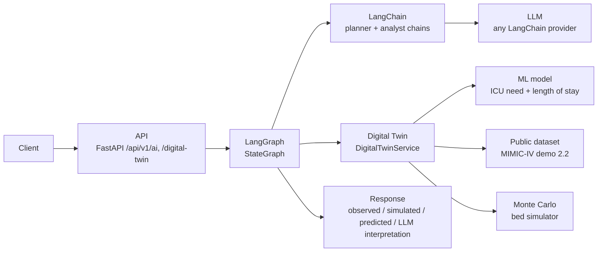
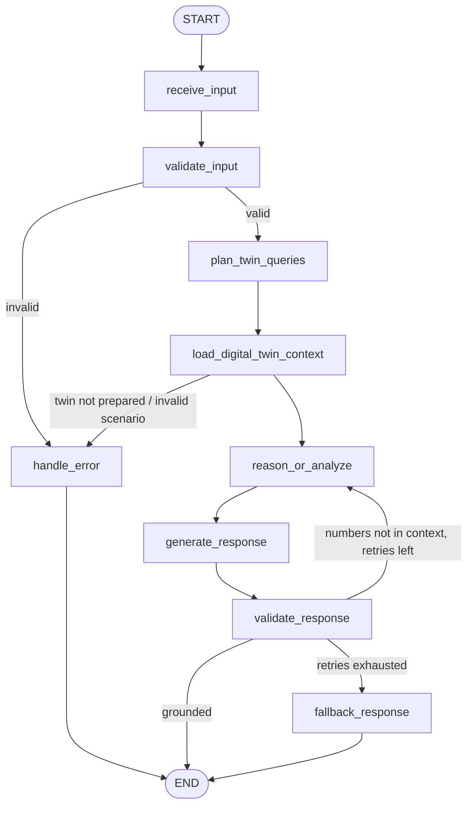

# ai_module — LangChain + LangGraph over a public-data digital twin

A standalone AI module for the Hospital Digital Twin platform:

- a **digital twin** of hospital bed capacity (ward + ICU) built end-to-end from a **public
  dataset** (MIMIC-IV Demo 2.2 + MIMIC-IV-ED Demo 2.2, ODbL). The pipeline runs ingestion →
  validation → cleaning → transformation → state → persistence → query → Monte Carlo
  simulation → ML prediction;
- a **LangChain** layer: provider-agnostic LLM factory, prompts kept in files, reusable
  chains with structured output, and tools over the twin;
- a **LangGraph** `StateGraph` that orchestrates the flow with typed state, conditional
  routes, numeric grounding and controlled fallbacks;
- a **component registry** that is the seam for a future **Langflow** integration
  (see [`docs/langflow-integration.md`](../docs/langflow-integration.md)).

The module imports **nothing** from `backend/`. The backend exposes it over HTTP through a
lazy bridge (`backend/app/services/ai_module_service.py`), which follows the same
convention as `langchain_module/`. The module is optional: when it is missing, those
endpoints answer 501 and the rest of the API is unaffected.

## Architecture



```
ai_module/
  config/        settings.py (AI_* env vars, pydantic-settings) · logging.py (JSON logs, request_id, redaction)
  schemas/       twin.py (ScenarioInput, PatientProfile, TwinState, SimulationResult, ...) · analysis.py (LLM outputs) · api.py
  digital_twin/  sources.py → ingest.py → validation.py → preprocess.py → profile.py / simulator.py
                 features.py · modeling.py · registry.py · store.py · service.py (DigitalTwinService)
                 prepare.py · train.py · evaluate.py   (CLIs)
  prompts/       *.md prompt files + loader (versioned by content hash)
  services/      llm_factory.py · grounding.py · response_renderer.py · language.py · ai_service.py (AIModule facade)
  chains/        analysis_chain.py · planner_chain.py (LLM) · template_analyst.py (deterministic) · base.py (interfaces)
  agents/        tools.py (LangChain tools over the twin) · twin_agent.py (optional tool-calling agent)
  graphs/        state.py (typed state) · nodes.py (one function per node) · builder.py (StateGraph)
  components/    registry.py (framework-agnostic specs — Langflow seam)
  data/          DATASET.md (dataset card) · raw/ · processed/        (generated, git-ignored)
  artifacts/     models/admission_outcome/<version>/                (generated, git-ignored)
  tests/         offline test suite (synthetic MIMIC-shaped data, scripted LLM)
```

## Requirements

- Python 3.11+ (the backend image uses 3.12; developed and tested on 3.14 and 3.11)
- `pip install -r ai_module/requirements.txt`. Inside the backend these come from
  `backend/requirements.txt` + `backend/requirements-assistant.txt`.
- Internet access once, to download the dataset (about 1 MB; later runs verify the files offline)
- An LLM API key is **optional**: with `AI_LLM_PROVIDER=none` everything except the LLM
  interpretation works

## Installation

```bash
# from the repository root
python -m venv ai_module/.venv
ai_module/.venv/Scripts/activate          # Windows; source ai_module/.venv/bin/activate on Linux/macOS
pip install -r ai_module/requirements.txt
cp ai_module/.env.example ai_module/.env  # then set AI_LLM_API_KEY / ANTHROPIC_API_KEY, or AI_LLM_PROVIDER=none
```

All commands below run **from the repository root**, which is the folder that contains `ai_module/`.

## Environment variables

All variables are optional and documented in [`.env.example`](.env.example).

| Variable | Default | Purpose |
|---|---|---|
| `AI_LLM_PROVIDER` | `anthropic` | any `init_chat_model` provider whose `langchain-<provider>` package is installed, or `none` |
| `AI_LLM_MODEL` | `claude-sonnet-5` | model name for that provider |
| `AI_LLM_API_KEY` | – | explicit key. When empty, the provider SDK reads its own variable (`ANTHROPIC_API_KEY`, `OPENAI_API_KEY`...) |
| `AI_LLM_TEMPERATURE` / `_TIMEOUT_SECONDS` / `_MAX_TOKENS` / `_MAX_RETRIES` / `_BASE_URL` | `0` / `60` / `1500` / `2` / – | model parameters |
| `AI_GRAPH_MAX_REGENERATIONS` | `1` | retries when the LLM writes numbers that are not in the twin |
| `AI_TWIN_BASELINE_DAILY_ADMISSIONS` | `20` | assumption: baseline admissions per day |
| `AI_TWIN_WARD_BEDS` / `AI_TWIN_ICU_BEDS` | Little's law | assumption: bed counts (empty = sized from observed stays) |
| `AI_TWIN_TARGET_OCCUPANCY` | `0.80` | occupancy target used to size beds with Little's law |
| `AI_TWIN_SIM_RUNS` / `_HORIZON_HOURS` / `_WARMUP_HOURS` / `AI_TWIN_RANDOM_SEED` | `100` / `168` / `720` / `42` | Monte Carlo settings |
| `AI_DATA_DIR` / `AI_ARTIFACTS_DIR` | `ai_module/data` / `ai_module/artifacts` | storage |
| `AI_LOG_LEVEL` / `AI_LOG_JSON` | `INFO` / `true` | logging |
| `AI_ENV_FILE` | `ai_module/.env` | alternative settings file |

## 1. Download and prepare the data

```bash
python -m ai_module.digital_twin.prepare            # download (SHA-256 verified) + validate + clean + transform + build state
python -m ai_module.digital_twin.prepare --offline  # re-run from the cached raw files
```

The command writes `data/raw/mimic-iv-demo-2.2/` (files exactly as published) and
`data/processed/` (`admissions.parquet`, `data_report.json`, `provenance.json`,
`twin_state.json`). It is idempotent. See [`data/DATASET.md`](data/DATASET.md) for the
source, license, columns, discarded variables, cleaning rules and assumptions.

## 2. Train and evaluate (separate from inference)

```bash
python -m ai_module.digital_twin.train       # new versioned artifact + metadata; updates latest.json
python -m ai_module.digital_twin.evaluate    # re-scores the recorded test patients, bootstrap 95% CI -> evaluation.json
```

- **Tasks**: ICU need (classification of `icu_flag`) and hospital length of stay in hours
  (regression on `log1p`). The features are only information available at admission time.
- **Protocol**: 60/20/20 train/validation/test split **grouped by patient**, so no patient
  appears in two partitions. Candidates (logistic regression with two C values or a random
  forest; ridge with two alphas or a random forest) are selected on validation, the
  selected model is refit on train+validation, and it is scored once on test against a
  naive baseline.
- **Artifact**: `artifacts/models/admission_outcome/<UTC timestamp>-<data sha8>/model.joblib`
  plus `metadata.json`. The metadata holds the version, date, parameters, candidate scores,
  test metrics, baselines, the split with the test patient IDs, the dataset provenance and
  SHA-256, and library versions.
- **Result on v2.2** (52 test admissions from unseen patients):

  | Task | Model | Test metric | Baseline | 95% bootstrap CI |
  |---|---|---|---|---|
  | ICU need | logistic regression (C=1) | ROC-AUC **0.726**, Brier 0.209 | Brier 0.254 (prevalence) | AUC 0.58–0.86 |
  | Length of stay | ridge on log hours (α=10) | MAE **91.1 h** | 101.5 h (train median) | MAE 65–120 h |

  The model beats the naive baselines. The data is small, so the intervals are wide and the
  model is indicative decision support, **not** a clinical tool.

The API never trains. It loads `latest.json` lazily, and if no model exists `predict`
answers with an explicit "run train" error (HTTP 503). Pickled models must be loaded with
the scikit-learn version they were trained with, so train inside the environment that
serves (see Docker below).

## 3. Run

```bash
# One request through the LangGraph workflow (prints the JSON InvokeResponse)
python -m ai_module "¿Qué pasa si llegan 60 víctimas en 4 horas?"
python -m ai_module "Estado de la UCI" --text
python -m ai_module "Simula una oleada" --parameters '{"scenario": {"surge_patients": 60, "surge_duration_hours": 4}}'
python -m ai_module --components           # the Langflow-ready component registry
```

```python
from ai_module import AIModule

module = AIModule()                                        # settings from AI_* / ai_module/.env
result = module.invoke("What if 60 casualties arrive over 4 hours?",
                       {"scenario": {"surge_patients": 60, "surge_duration_hours": 4, "surge_start_hour": 12}})
print(result.response)               # text with separate observed / simulated / predicted / interpretation sections
result.digital_twin["simulated"]     # exact numbers from the twin
result.metadata["execution_history"] # node-by-node trace with durations

module.simulate({"surge_patients": 60, "icu_beds": 60})   # direct twin calls, no LLM
module.predict({"age": 78, "sex": "M", "ed_acuity_esi": 1})
```

### Through the backend API

Start the backend as usual (`uvicorn app.main:app` from `backend/`, or `docker compose up`).
It finds the module at `<repo>/ai_module`, or at `AI_MODULE_ROOT`. The endpoints live under
the backend's `/api/v1` prefix and use its JWT authentication.

| Method & path | Permission | Body | Returns |
|---|---|---|---|
| `POST /api/v1/ai/invoke` | `assistant:ask` (sends data to the LLM provider) | `{"message": "...", "parameters": {"intent"?, "scenario"?, "patient"?, "include_timeline"?}}` | `{"request_id", "response", "digital_twin", "analysis", "metadata"}` |
| `GET /api/v1/ai/status` | logged in | – | readiness of twin data, model and LLM (no secrets) |
| `GET /api/v1/digital-twin/state` | logged in | – | `TwinState` |
| `POST /api/v1/digital-twin/simulate[?include_timeline=true]` | `simulation:run` | `ScenarioInput` | `SimulationResult` |
| `POST /api/v1/digital-twin/predict` | `simulation:run` | `PatientProfile` | `PredictionResult` |

Errors never include stack traces or secrets. Invalid input returns **422** with field
messages. Data not prepared or model not trained returns **503** with the command to run.
If the module is not installed, the endpoints return **501**.

Example (real output on the MIMIC-IV demo with `AI_LLM_PROVIDER=none`; timeline omitted):

```bash
curl -X POST http://localhost:8000/api/v1/ai/invoke -H "Authorization: Bearer $TOKEN" -H "Content-Type: application/json" \
  -d '{"message": "What happens if 60 casualties arrive over 4 hours?",
       "parameters": {"scenario": {"surge_patients": 60, "surge_duration_hours": 4, "surge_start_hour": 12},
                      "patient": {"age": 78, "sex": "M", "ed_acuity_esi": 1}}}'
```

```text
Digital twin status: RED. Answer generated by deterministic rules (no LLM interpretation).

## Observed data (public dataset MIMIC-IV Clinical Database Demo + MIMIC-IV-ED Demo v2.2)
- 275 admissions of 100 patients; ICU admission 46.5%; median length of stay 116.5 h (p90 348.1 h); in-hospital mortality 5.5%.

## Simulation — normal operation (100 Monte Carlo runs, 168 h)
- Ward: 126 beds, mean utilization 80.1%, mean peak 112.0. ICU: 47 beds, mean utilization 80.9%, mean peak 44.2, probability of filling up 39.0%. Mean wait per patient 0.35 h. Status: YELLOW.

## Simulation — requested scenario (100 Monte Carlo runs, 168 h)
- Ward: 126 beds, mean utilization 94.8%, mean peak 125.8. ICU: 47 beds, mean utilization 95.2%, mean peak 47.0, probability of filling up 100.0%. Mean wait per patient 12.24 h. Status: RED.
- Surge: 60 extra patients over 4 h from hour 12; ESI mix {'1': 0.107, '2': 0.528, '3': 0.365}.

## Prediction (model 20260928T170847Z-7e69bb9d)
- Probability of needing ICU 0.837; estimated stay 130.7 h (5.4 days). Test ROC-AUC 0.7259.

## Interpretation (deterministic rules; not data)
- [observed] In the dataset, 46.5% of 275 admissions needed ICU and the median length of stay was 116.5 hours.
- [simulated] In the simulated scenario the ICU reaches a mean utilization of 95.2% and the ward 94.8% (status RED).
- [predicted] Estimated probability of needing ICU: 0.837; estimated length of stay: 130.7 hours.
...
```

The JSON `metadata` contains `status` (`completed` | `rejected` | `failed`), `intent`,
`plan_source`, `llm` {`provider`, `model`, `configured`, `used`, `fallback`}, `grounded`,
`attempts`, `duration_ms`, `execution_history`, non-fatal `errors`, `dataset`,
`model_version` and `prompt_versions`.

### Docker

`docker-compose.yml` mounts `./ai_module` at `/opt/ai/ai_module` and sets
`AI_MODULE_ROOT=/opt/ai`. Put `AI_*` variables in `backend/.env`. Prepare and train
**inside** the container so the artifacts match its library versions:

```bash
docker compose up --build -d
docker compose exec -w /opt/ai backend python -m ai_module.digital_twin.prepare
docker compose exec -w /opt/ai backend python -m ai_module.digital_twin.train
docker compose restart backend        # or call ai_module_service.reset(); the module caches the loaded model
```

## Tests

```bash
python -m pytest ai_module/tests -q            # 90 tests, offline, no API calls
cd backend && python -m pytest -q              # includes tests/test_ai_module_endpoints.py
```

The tests use synthetic tables with the MIMIC schema, so they need no download, and a
scripted chat model instead of an LLM, so they cost nothing. They cover:

- the dataset pipeline (checksums, validation, cleaning rules, anchor-age method);
- the simulator (determinism, capacity bounds, surge effect, Little's law);
- `DigitalTwinService` (persistence, stale-state rebuild, missing data/model);
- training and evaluation (patient-grouped split, metadata, reproducibility);
- schemas, grounding and log redaction;
- chains (structured output, error wrapping, provider factory), tools and agent;
- every graph node on its own, and end-to-end runs: LLM planner → twin → grounded analysis,
  regeneration, fallback, rejection, failure, prediction, and `request_id` in logs.

## How it works

### LangChain layer

- `services/llm_factory.py` builds the chat model with `init_chat_model(model, model_provider=...)`
  from settings only. Changing provider is a configuration change: set `AI_LLM_PROVIDER` and
  `AI_LLM_MODEL` and install `langchain-<provider>`.
- `prompts/*.md` hold the system and user prompts. They are loaded into `ChatPromptTemplate`s,
  and their content hash is reported in every response.
- `chains/analysis_chain.py` is `prompt | model.with_structured_output(AnalysisOutput)`.
  `chains/planner_chain.py` is `prompt | model.with_structured_output(TwinQueryPlan)`, which
  extracts **only user-stated** parameters, validated by the same schemas as the API.
- `chains/base.py` defines the `Analyst` / `Planner` interfaces. The deterministic
  `TemplateAnalyst` / `RulePlanner` implement them too, so the graph works without an LLM
  and survives LLM failures.
- `agents/tools.py` provides the `get_digital_twin_state`, `simulate_scenario` and
  `predict_admission` tools. `agents/twin_agent.py` is an optional `create_agent` over
  those tools.

### LangGraph workflow



- **State** (`graphs/state.py`, `TypedDict`): `request_id`, `user_input`, `validated_input`,
  `language`, `plan`, `digital_twin_context`, `model_input`, `model_output`, `response`,
  `attempts`, `validation_feedback`, `status`, `metadata`, `errors` (append-only) and
  `execution_history` (append-only).
- **Nodes** (`graphs/nodes.py`) are plain functions `(state, deps) -> update` that delegate
  to services and chains. Each one is wrapped by `instrument()` for timing, a structured log,
  the history entry, and turning any unexpected exception into a controlled `failed` status.
- **Explicit `parameters` win over the LLM planner**, which gives deterministic, auditable
  calls.
- **Grounding** (`services/grounding.py`): every number the LLM writes must match a value in
  the twin context or the user's input. Legitimate rounding is allowed, as are fraction ↔
  percent and hours → days conversions. Otherwise the analyst is re-prompted with the
  offending numbers. If it still fails, a deterministic answer replaces it and
  `metadata.grounded=false`.
- **Response** (`services/response_renderer.py`): the observed, simulated and predicted
  sections are rendered **by code** from the twin. The LLM's text appears only under
  "Interpretation (generated by LLM ...; not data)".

### Digital twin

| Step | Where |
|---|---|
| 1. Public dataset | `digital_twin/sources.py` (fixed URLs, license, citations) |
| 2. Ingestion | `ingest.py` (download, SHA-256 check against PhysioNet's published sums) |
| 3. Validation | `validation.py` (raw + processed) |
| 4-5. Cleaning & transformation | `preprocess.py` → one row per admission, `DataReport` audit |
| 6. Digital state | `profile.py` (observed profile) + capacity (assumptions) + baseline simulation → `TwinState` |
| 7. Persistence | `store.py` (`twin_state.json`, rebuilt automatically if the data or settings change) |
| 8. Query | `DigitalTwinService.get_current_state()` / `get_context()` |
| 9. Simulation / prediction | `simulator.py` (Monte Carlo) · `modeling.py` + `registry.py` (ML) |
| 10. Exposure to LangGraph | `get_context()` → node `load_digital_twin_context`; LangChain tools |

**Simulation model.** Baseline arrivals are Poisson and follow the observed arrival
profile by hour. Each patient is a bootstrap draw of a *real* admission: surge patients are
drawn from real ED admissions of the requested ESI level, keeping their observed ICU and
ward hours. ICU is used first, then the ward. Beds are assigned by ESI priority, then
arrival order, and patients without a bed wait. A 720 h warm-up is discarded. Results are
aggregated over seeded runs, so they are reproducible. Status colors use the backend
twin's thresholds (utilization < 60% GREEN, < 85% YELLOW, otherwise RED) on the
most-loaded unit.

The simulation does not model deaths while waiting, transfers, staffing limits, or
discharge timing by time of day. Bed counts and the baseline admission rate are
configurable **assumptions**, not data, and are labeled as such everywhere.

### Observability

JSON logs (`config/logging.py`) record these events: `graph_node` (node, status,
duration_ms), `llm_call` (chain, model, duration, status, input size), `twin_query`
(operation, duration), `twin_pipeline`, `model_loaded`, `response_ungrounded` and
`ai_invoke`. Every event carries the `request_id`. User text and model output are never
logged, and keys named like `api_key`, `token`, `secret` or `authorization`, plus values
that look like `sk-...` or `Bearer ...`, are redacted.

### Langflow (future)

The module does not depend on Langflow. `components/registry.py` describes every building
block (state, simulate, predict, planner, analyst, graph, prompts) with typed inputs and
outputs and a `build()` callable. A Langflow component will be a thin wrapper around it.
See [`docs/langflow-integration.md`](../docs/langflow-integration.md).
