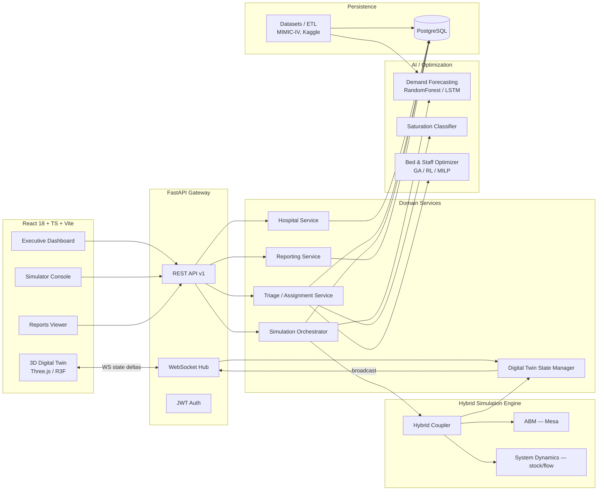
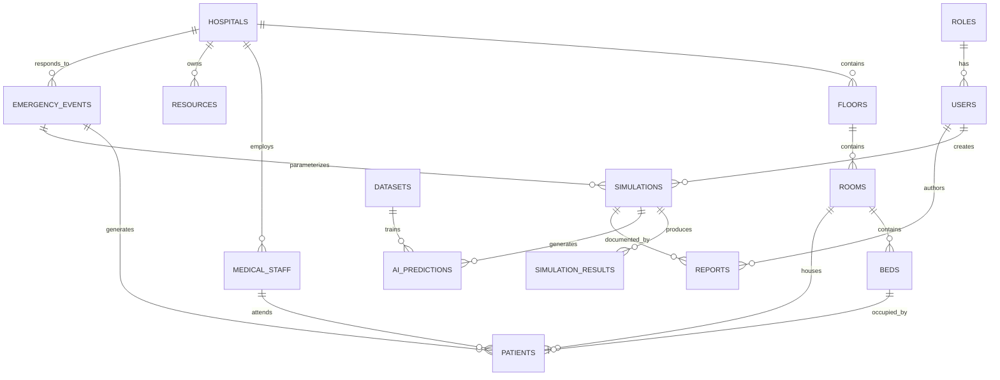

# Digital Twin-Driven Real-Time Optimization of Hospital Resource Allocation During Mass Casualty Events
### Hybrid Agent-Based + System Dynamics Model — Architecture & Design Document

Status: Reference architecture + functional prototype
Audience: engineering team, academic reviewers, hospital emergency-management stakeholders

---

## 1. Vision and Scope

Mass Casualty Events (MCEs) — earthquakes, transport disasters, terrorist attacks, industrial
accidents — impose sudden, non-linear demand shocks on hospital systems. Classical static
capacity planning (fixed bed counts, fixed staffing ratios) fails under these shocks because the
system's bottlenecks *move* over time (triage → ER → imaging → OR → ICU → ward → discharge) and
interact with feedback loops (staff fatigue, bed turnover delay, ambulance diversion).

This project builds a **3D Digital Twin** of a hospital that is continuously synchronized with a
**hybrid simulation core**:

- **Agent-Based Model (ABM)** — captures *micro* behavior: individual patients, clinicians, and
  discrete resources (beds, ORs, ambulances) with heterogeneous state and stochastic transitions.
- **System Dynamics (SD) model** — captures *macro* behavior: aggregate stocks/flows (queue
  lengths, occupancy, saturation index) and the feedback loops that ABM alone renders expensive to
  reason about analytically.
- **AI layer** — forecasts demand, predicts saturation, and recommends resource reallocation,
  trained on public datasets (MIMIC-IV, PhysioNet, Kaggle hospital datasets) and on simulation
  output (synthetic augmentation for the MCE regime, which real data barely covers).

The system is not a toy visualization: the 3D scene is a *rendering surface* over a live
simulation/production state object (`HospitalDigitalTwinState`), the same pattern used in
industrial digital twins (state → serialization → render), so the same backend state can drive
the 3D view, the dashboard KPIs, the AI models, and the exported reports without divergence.

---

## 2. Architectural Style

**Modular monolith, service-oriented internally, containerized, real-time-first.**

Rationale: a hospital emergency-ops prototype needs low operational complexity (one Postgres, one
API process, one frontend) while remaining internally decomposed so that each concern (simulation,
AI, reports, twin state) can later be extracted into its own microservice/worker without a
rewrite. FastAPI's async model plus a WebSocket broadcast bus gives us the real-time property
without needing Kafka/Redis at prototype scale; the design leaves an explicit seam
(`app/services/event_bus.py`) where Redis Pub/Sub or Kafka can be substituted for multi-instance
scaling.



---

## 3. Component Responsibilities

| Component | Responsibility | Key tech |
|---|---|---|
| `app/api` | HTTP/WS surface, request validation, auth guards | FastAPI, Pydantic |
| `app/authentication` | JWT issuance/verification, RBAC (roles table) | python-jose, passlib |
| `app/models` | SQLAlchemy ORM — durable state | SQLAlchemy 2.0, PostgreSQL |
| `app/schemas` | Pydantic DTOs — API contracts, decoupled from ORM | Pydantic v2 |
| `app/services` | Application/business logic, orchestrates models + simulation | plain Python |
| `app/simulation/abm` | Micro-level agents: Patient, Clinician, Bed, OR, Ambulance | Mesa |
| `app/simulation/system_dynamics` | Macro stock/flow model, Euler/RK4 integration | NumPy/SciPy |
| `app/digital_twin` | Canonical live state of the physical hospital + serializer for 3D/WS | dataclasses, Pydantic |
| `app/artificial_intelligence` | Forecasting, classification, optimization | scikit-learn, XGBoost, PyTorch (LSTM), DEAP (GA) |
| `app/reports` | DOCX/PDF/XLSX generation from simulation results | python-docx, ReportLab, openpyxl/pandas |
| `app/datasets` | ETL: ingest, clean, normalize public datasets | pandas |
| `frontend/DigitalTwin` | 3D scene: floors, rooms, beds, staff, patients, status colors | React Three Fiber |
| `frontend/Dashboard` | KPIs, alerts, live saturation gauges | Recharts/D3 |
| `frontend/Simulator` | Scenario configuration + run control | React Hook Form |

---

## 4. Data Flow (Mass Casualty Scenario, end-to-end)

1. Operator opens **Simulator**, defines an `EmergencyEvent` (e.g. "Earthquake M8.0", 120 victims,
   severity distribution, arrival curve, horizon = 6h) → `POST /api/v1/simulations`.
2. `SimulationOrchestrator` creates a `SimulationRun` row, seeds the **ABM** with the hospital's
   current `Bed`/`Room`/`MedicalStaff` snapshot, and seeds the **SD model** with current stocks
   (occupied beds, active staff, queue length).
3. Each simulation tick (configurable Δt, default 1 simulated minute):
   - ABM step: patient arrivals instantiate `PatientAgent`s (age, severity via START/METTAG-style
     triage, resource needs); agents traverse a `SimPy`-free discrete-event state machine
     (`ARRIVED → TRIAGED → WAITING_BED → IN_TREATMENT → ICU|WARD|DISCHARGED|DECEASED`); the
     **Assignment Service** greedily/optimally binds agents to available `BedAgent`/`StaffAgent`
     using the priority queue produced by triage.
   - SD step: aggregate stocks (`patients_waiting`, `beds_occupied`, `staff_active`,
     `saturation_index`) are updated from the ABM's realized flows *and* independently evolve via
     the continuous feedback equations (Section 6.2) to capture effects the ABM does not model at
     per-agent granularity (fatigue accumulation, resource depletion, diversion response).
   - Hybrid coupler reconciles ABM discrete counts into SD stocks every tick (two-way coupling —
     see Section 6.3), preventing the two models from diverging.
   - `DigitalTwinStateManager` receives the reconciled state, updates room/bed color-coded status
     (green/yellow/red), and pushes a **state delta** over WebSocket to all connected clients.
4. The **3D Twin** re-renders only the changed instances (instanced meshes, no full scene rebuild).
   The **Dashboard** updates KPI tiles and alert banners from the same delta stream.
5. At tick boundaries the **AI layer** is invoked opportunistically (every N ticks, configurable):
   `DemandForecaster` predicts next-horizon arrivals; `SaturationClassifier` flags rooms/floors
   trending to red; `ResourceOptimizer` proposes a re-allocation (e.g., "open overflow ward",
   "recall 2 surgeons") which is surfaced as a **recommendation**, not auto-applied (human-in-the-
   loop by design — this is a decision-support system, not an autonomous controller).
6. At the end of the run (or on demand), `ReportingService` renders DOCX/PDF/XLSX from
   `SimulationResult` rows.

---

## 5. Database Design (PostgreSQL)

### 5.1 Entity-Relationship Overview



### 5.2 Core Tables (summary — full DDL in `backend/app/models/`)

- **roles**(id, name, permissions jsonb)
- **users**(id, email, hashed_password, role_id FK, is_active, created_at)
- **hospitals**(id, name, location geography/point, total_capacity, created_at)
- **floors**(id, hospital_id FK, level, name, floor_type enum[ER, ICU, SURGERY, WARD, IMAGING])
- **rooms**(id, floor_id FK, code, room_type enum[TRIAGE, RESUS, OR, ICU, WARD], capacity,
  position_x/y/z float — for 3D placement, status enum[GREEN, YELLOW, RED])
- **beds**(id, room_id FK, code, bed_type enum[ER, ICU, WARD, OR_TABLE], status enum[AVAILABLE,
  OCCUPIED, CLEANING, OUT_OF_SERVICE], patient_id FK nullable)
- **patients**(id, event_id FK nullable, room_id FK nullable, bed_id FK nullable, age, sex,
  diagnosis, severity_level enum[1..5 / START triage color], triage_priority int, arrival_time,
  max_wait_time_minutes, resource_needs jsonb, status enum[ARRIVED, TRIAGED, WAITING, IN_TREATMENT,
  ICU, WARD, DISCHARGED, DECEASED])
- **medical_staff**(id, hospital_id FK, role enum[DOCTOR, NURSE, SURGEON, PARAMEDIC], specialty,
  shift enum[DAY, NIGHT, ON_CALL], workload_score float, is_available bool)
- **resources**(id, hospital_id FK, resource_type enum[VENTILATOR, AMBULANCE, IMAGING, OR_KIT, ...],
  quantity_total, quantity_available)
- **emergency_events**(id, hospital_id FK, name, event_type enum[EARTHQUAKE, EXPLOSION, TRANSPORT,
  INDUSTRIAL, OTHER], magnitude/severity, expected_victims, started_at, params jsonb)
- **simulations**(id, event_id FK, created_by FK→users, horizon_minutes, timestep_minutes, status
  enum[PENDING, RUNNING, COMPLETED, FAILED], started_at, finished_at, config jsonb)
- **simulation_results**(id, simulation_id FK, tick, timestamp, metrics jsonb — stocks/flows
  snapshot, indexed on (simulation_id, tick))
- **ai_predictions**(id, simulation_id FK nullable, dataset_id FK nullable, model_name,
  model_version, target, prediction jsonb, confidence, created_at)
- **datasets**(id, name, source enum[MIMIC_IV, PHYSIONET, KAGGLE, GOV_OPEN, SYNTHETIC], version,
  storage_uri, schema_hash, ingested_at)
- **reports**(id, simulation_id FK, author_id FK→users, format enum[DOCX, PDF, XLSX], storage_path,
  generated_at)

Cross-cutting: every mutable table carries `created_at`/`updated_at`; state-changing tables
(`patients`, `beds`, `simulations`) are mirrored by an **audit** pattern
(`*_audit_log` via a generic `AuditLogMixin` + SQLAlchemy `after_update`/`after_insert` events) so
that resource-allocation decisions during an MCE are forensically reconstructable — this is a
regulatory expectation for hospital systems, not an optional nicety. Indexes: FK columns, plus
`(hospital_id, status)` on `beds`/`rooms` (hot path for the twin's real-time coloring query) and
`(simulation_id, tick)` on `simulation_results` (hot path for report generation and time-series
charts).

---

## 6. Simulation Model Design

### 6.1 Agent-Based Model (Mesa)

Agents (see `backend/app/simulation/abm/agents.py`):

- **PatientAgent**: `age, sex, diagnosis, severity (1-5, START-derived), triage_priority,
  max_wait_minutes, resource_needs: {bed_type, needs_surgery, needs_icu, needs_imaging},
  status`. Behavior: a finite-state machine stepped once per tick; state transition depends on
  resource availability queried from the model's schedulers and on elapsed wait vs.
  `max_wait_minutes` (breach → severity escalation → possible `DECEASED` if untreated red-tag).
- **ClinicianAgent** (doctor/surgeon): `specialty, shift, capacity (max concurrent patients),
  fatigue (increases with active minutes, degrades effective capacity — this is the ABM's carrier
  of the SD "staff fatigue" feedback loop)`.
- **NurseAgent**: `assigned_area, capacity`.
- **BedAgent / ORAgent / AmbulanceAgent**: resource agents with `status`
  (AVAILABLE/OCCUPIED/CLEANING/OUT_OF_SERVICE) and `turnover_time` (cleaning/prep delay before
  reuse — the single largest lever on effective capacity during an MCE, and the one most static
  planning models omit).

Scheduling: `mesa.time.RandomActivation` for patients/staff (order-independent fairness), a custom
`ResourceExchange` step run once per tick that solves the **assignment sub-problem**: given the
current waiting-patient priority queue (sorted by `triage_priority`, ties broken by
`arrival_time`) and the set of available beds/staff, assign greedily by descending priority
(baseline) or, when the AI optimizer is enabled, using its recommended allocation (Section 6.4/7).

### 6.2 System Dynamics Model

State variables (stocks): `Patients_Waiting, Patients_In_Treatment, Beds_Occupied, Staff_Active,
Saturation_Index ∈ [0,1]`.

Representative equations (Euler integration, Δt = timestep_minutes; full implementation in
`system_dynamics/sd_model.py`):

```
dPatients_Waiting/dt   = ArrivalRate(t) - AdmissionRate(t) - EscalationLossRate(t)
dBeds_Occupied/dt      = AdmissionRate(t) - DischargeRate(t)
dStaff_Fatigue/dt       = k1 * Staff_Active - k2 * RestRate
AdmissionRate(t)        = min(AvailableBeds(t) / TurnoverDelay, Patients_Waiting(t) / τ_admit)
Saturation_Index(t)     = w1*(Beds_Occupied/Capacity) + w2*(Patients_Waiting/QueueRef)
                           + w3*(1 - StaffEffective/StaffRef)
```

`Saturation_Index` is the single scalar the dashboard and the AI classifier key off of; its
threshold bands (green < 0.6, yellow 0.6–0.85, red > 0.85) drive the 3D twin's per-zone coloring
when zone-level aggregation is applied (each room/floor computes its own local saturation index
from the ABM's occupancy in that zone).

### 6.3 Hybrid Coupling Strategy

This is the core scientific contribution the paper title promises, so it is made explicit rather
than left implicit in code:

- **ABM → SD (bottom-up)**: every tick, `Beds_Occupied`, `Patients_Waiting`, `Staff_Active` are
  *recomputed directly* from the ABM's agent population (a census, not an estimate). This keeps SD
  stocks ground-truthed to the discrete reality instead of drifting.
- **SD → ABM (top-down)**: `Staff_Fatigue` and `Saturation_Index` computed by the SD layer feed
  back into ABM agent behavior — `ClinicianAgent.effective_capacity = base_capacity * (1 -
  fatigue)`, and `PatientAgent` triage re-evaluation probability increases with
  `Saturation_Index` (models real behavior: overloaded systems re-triage more aggressively).
- This is a **discrete-continuous hybrid** (cf. Brailsford et al.'s hybrid simulation taxonomy for
  healthcare OR): ABM supplies the individual-level realism System Dynamics cannot (heterogeneous
  patients, discrete bed counts, stochastic arrivals), while SD supplies the aggregate feedback
  and fast what-if exploration ABM alone makes computationally and conceptually expensive (you
  cannot easily ask "what is the system's fatigue feedback gain" from 10,000 agent trajectories,
  but you can from four SD equations calibrated against the ABM's output).

### 6.4 Optimization Layer

Three complementary techniques, applied at different decision horizons:

| Technique | Decision | Why chosen |
|---|---|---|
| **Genetic Algorithm** (DEAP) | Static/slow reallocation: which overflow rooms to open, how to redistribute on-call staff across specialties, for a *given* forecast horizon | Combinatorial, non-differentiable, mixed discrete search space (room/staff assignment) where GA's population search handles multi-modal objectives (minimize wait time *and* minimize staff overtime) better than gradient methods; no need for a differentiable surrogate. |
| **Reinforcement Learning** (tabular Q-learning / PPO stub, `stable-baselines3` optional) | Sequential, online bed/OR assignment policy that adapts tick-by-tick as the MCE unfolds | The assignment problem is inherently sequential with delayed reward (a bed given to a moderate patient now may block a critical patient later); RL directly optimizes the long-horizon objective the greedy/GA baselines only approximate. Used as a *policy the simulator can run in place of the greedy baseline*, not as a production auto-pilot. |
| **MILP baseline** (PuLP, small scale only) | Optimal one-shot assignment for validation | Gives a provable-optimal reference on small instances (< ~50 patients) to sanity-check the GA/RL/greedy heuristics — standard practice: validate heuristics against exact solutions where tractable. |

Predictive models (Section 7) inform all three by supplying the forecasted arrival stream they
optimize against.

---

## 7. AI / Predictive Layer — Model Selection and Justification

| Task | Candidate models evaluated | Selected | Justification |
|---|---|---|---|
| Short-horizon arrival/demand forecasting | RandomForest, XGBoost, LSTM | **LSTM (primary) + XGBoost (baseline/fallback)** | Arrivals during an MCE are a non-stationary, autocorrelated time series (surge → decay); LSTM captures temporal dependencies tree ensembles ignore. XGBoost retained as a fast, low-data-regime fallback (it outperforms LSTM when historical MCE data per hospital is scarce, which is the realistic case — most hospitals have few MCE events logged) and as an interpretable baseline (feature importances) for the report's methodology section. |
| Saturation / bed-crisis classification | Logistic Regression, SVM, RandomForest, XGBoost | **RandomForest (primary), SVM (ablation baseline)** | Saturation is driven by threshold-like interactions between occupancy, staffing, and arrival rate that tree ensembles capture natively (no feature scaling, robust to the outliers an MCE regime produces); SVM kept as a margin-based baseline to report against for the paper's comparison table, but its poor scalability and sensitivity to kernel/scaling choices make it unsuitable as the deployed model. |
| Bed/staff reallocation recommendation | GA, RL, MILP | See Section 6.4 | — |
| Triage priority support (decision aid, not replacement) | Rule-based (START/SALT) + gradient-boosted re-ranking | **Rule-based primary, ML re-ranking as secondary signal only** | Patient safety and auditability require the primary triage logic to be a transparent, clinically validated protocol (START/SALT), not a black box; ML is used only to flag priority-queue re-ordering suggestions surfaced to clinicians, never to auto-triage. |

All models are trained via `backend/app/artificial_intelligence/training/` scripts against (a)
ETL'd public datasets for baseline demand/vitals patterns and (b) synthetic MCE traces generated
by running the ABM/SD engine itself under randomized scenario parameters — because real MCE
datasets are, definitionally, rare and under-labeled. This simulation-to-train / simulation-to-
validate loop is documented explicitly in the report generator's methodology appendix so results
are reproducible and the synthetic-data dependency is not hidden.

---

## 8. Digital Twin 3D Design

`DigitalTwinStateManager` (backend) owns a single `HospitalDigitalTwinState` object: hospital →
floors → rooms → beds/staff/patients, each carrying a `status_color` derived from local
saturation. This object is:

1. Persisted incrementally to Postgres (source of truth),
2. Serialized to a compact delta payload (`{entity_type, id, changed_fields}`) on every simulation
   tick or manual mutation,
3. Broadcast over the WebSocket hub to all subscribed frontend clients.

Frontend (`React Three Fiber`): the hospital is modeled as a scene graph mirroring
`hospital → floor (Y offset) → room (footprint box) → bed/equipment (instanced mesh)`. Instanced
meshes are used for beds/staff/patients (hundreds of similar objects) with per-instance color
attribute driven by status, so a full MCE surge (hundreds of patients) renders as one draw call per
entity type rather than hundreds of draw calls — required for real-time performance on commodity
hardware, which is a hospital ops-center's typical deployment target, not a GPU workstation.
Camera: `OrbitControls` for free navigation/zoom/rotation; raycasting on click resolves the
instance ID back to a domain entity ID for the selection/inspector panel.

---

## 9. Frontend Application Structure

- **Executive Dashboard**: hospital-wide KPIs (occupancy %, avg wait time, saturation index,
  active alerts) via Recharts, refreshed from the WS delta stream.
- **3D Digital Twin Viewer**: as above; a side panel shows the selected entity's live attributes.
- **Simulator Console**: form-driven scenario builder (event type, magnitude, victim count,
  severity distribution, arrival curve shape, horizon) → `POST /simulations`, then a run-control
  panel (play/pause/speed) and live chart of stocks as the run progresses.
- **Reports**: list of generated `Report` rows with download links (DOCX/PDF/XLSX), and a
  "Generate report" action against a completed `Simulation`.

State management: React Query for server state (REST), a small Zustand store for the live
WS-driven twin state (kept out of React Query's cache model because it's a stream of deltas, not
request/response data).

---

## 10. Security, Testing, Deployment

- **AuthN/Z**: JWT (access + refresh), password hashing via `passlib[bcrypt]`, RBAC via
  `roles.permissions` checked in a FastAPI dependency (`require_permission("simulation:run")`).
- **Testing** (`backend/tests`): unit tests for SD equations (closed-form checks at equilibrium),
  ABM agent transition tests (deterministic seed), API contract tests (`httpx.AsyncClient` against
  the FastAPI app), a smoke test that runs a short simulation end-to-end and asserts monotonic
  invariants (occupied beds ≤ capacity, no negative stocks). See `docs/TEST_PLAN.md`.
- **Containerization**: `docker-compose.yml` with `postgres`, `backend` (FastAPI/Uvicorn), and
  `frontend` (Vite dev / Nginx-served build) services; backend depends_on postgres with a
  healthcheck; Alembic migrations run as a one-shot init container step.

---

## 11. Roadmap

| Phase | Scope |
|---|---|
| 0 — Prototype (this delivery) | DB schema, hybrid sim engine (baseline greedy assignment), 3D twin MVP, REST+WS API, DOCX/PDF/XLSX export, Dockerized dev environment |
| 1 | ETL real datasets end-to-end (MIMIC-IV demo done: download + checksum + ETL + API + UI; Kaggle and full MIMIC-IV pending); train and persist LSTM + RandomForest/XGBoost models; replace stub forecasts with trained artifacts |
| 2 | GA + RL optimizer wired into the assignment sub-problem; MILP validation harness; A/B comparison report vs. greedy baseline |
| 3 | Multi-hospital regional view (network of twins, ambulance routing between facilities); Redis/Kafka event bus for horizontal scaling of the WS hub |
| 4 | Clinical validation study design (retrospective replay against historical MCE logs where available), IRB-ready methodology writeup, external audit of triage-support model for bias/safety |

Full install/run instructions: see `README.md`. Test plan: `docs/TEST_PLAN.md`.
