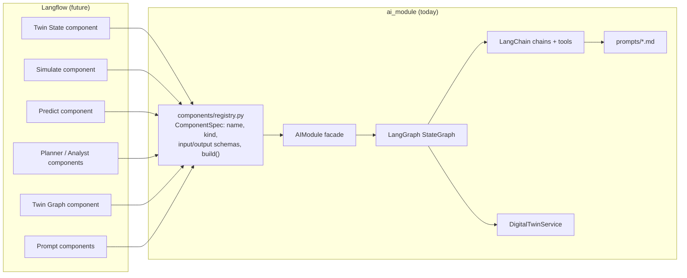

# Digital-twin Langflow integration guide (future phase)

**Status:** prepared, not integrated. `ai_module` does not import or depend on Langflow.
This status applies to the digital-twin components below. The separate ML
comparison flow is implemented in `langflow_integration/`; see its
[setup guide](../langflow_integration/README.md).
The business logic lives in plain Python services, LangChain runnables and a LangGraph
graph. Langflow will be an **additional presentation/orchestration layer** made of thin
adapters, and adding it requires no rewrite.

## 1. Design principle: one seam



Every building block is already described in `ai_module/components/registry.py` as a
`ComponentSpec`:

- **name** and **kind** (`service`, `tool`, `chain`, `graph`, `prompt`);
- **input_schema / output_schema** (Pydantic models; `describe()` exports them as JSON Schema);
- **build(module)**, which returns a `dict -> dict` callable with validated input and JSON output.

A Langflow component only has to translate its UI inputs into that dict and return the
dict as its output. You can list the registry with:

```bash
python -m ai_module --components
```

## 2. Components to expose

| Registry name | Kind | Inputs | Outputs | Backed by |
|---|---|---|---|---|
| `digital_twin_state` | service | none | `TwinState`: `observed` (dataset profile), `capacity` (assumptions), `baseline` (simulation), `status_color`, `provenance` | `DigitalTwinService.get_current_state` |
| `digital_twin_simulate` | tool | `ScenarioInput`: `surge_patients`, `surge_start_hour`, `surge_duration_hours`, `surge_esi_mix`, `baseline_daily_admissions`, `ward_beds`, `icu_beds`, `horizon_hours`, `runs`, `seed` (all optional) | `SimulationResult`: ward/ICU `UnitStats`, `waiting`, `status_color`, `timeline`, `assumptions` | `DigitalTwinService.simulate` |
| `digital_twin_predict` | tool | `PatientProfile`: `age`, `sex`, `admission_type`, `admission_location`, `admit_hour`, `arrived_via_ed`, `arrival_transport`, `ed_acuity_esi`, `triage_*` | `PredictionResult`: `icu_probability`, `predicted_los_hours/days`, `model` (version, test metrics), `unknown_categories` | `DigitalTwinService.predict` |
| `twin_query_planner` | chain | `question` | `TwinQueryPlan`: `intent`, `scenario?`, `patient?` | `LLMPlanner` (LLM) / `RulePlanner` |
| `twin_analyst` | chain | `question`, `context` (a `TwinContext` dict), `language` | `AnalysisOutput`: `answer`, `findings[{statement, source}]`, `recommendations`, `caveats` | `LLMAnalyst` / `TemplateAnalyst` |
| `twin_graph` | graph | `InvokeRequest`: `message`, `parameters{intent?, scenario?, patient?, include_timeline?}` | `InvokeResponse`: `request_id`, `response`, `digital_twin`, `analysis`, `metadata` | the compiled `StateGraph` |
| `prompt` | prompt | `name` (`analyst_system`, `analyst_user`, `planner_system`, `planner_user`, `agent_system`) | `{name, text}` | `ai_module/prompts/*.md` |

The LangChain tools (`agents/tools.py`: `get_digital_twin_state`, `simulate_scenario`,
`predict_admission`) are standard `BaseTool`s. Langflow's *Agent* component can use them
directly through a "Tool" output (see §4).

## 3. How to connect the graph

There are two options, and they can coexist:

**A. Graph as a single component (recommended first step).** One Langflow component wraps
`twin_graph`. The flow is `Chat Input → Twin Graph → Chat Output`. Validation, twin
queries, the numeric grounding check, the regeneration loop and the fallbacks all stay
inside LangGraph, which keeps behaviour identical to `POST /api/v1/ai/invoke`.

**B. Graph unfolded into Langflow nodes (for experimentation).**
`Chat Input → twin_query_planner → digital_twin_simulate / digital_twin_predict → twin_analyst → Chat Output`.
This option is useful for prompt iteration, but it loses the grounding and regeneration
loop unless you re-create it in Langflow. Keep option A for production.

The same LLM configuration applies in both cases. The components receive an `AIModule`
built from `AI_*` settings, so provider, model and keys stay outside the flow JSON.

## 4. Adapter sketch (to be written in the Langflow phase)

Langflow's custom component API changes between versions. Pin one version and check its
docs; the shape below is illustrative only.

```python
# langflow_components/twin_graph.py  (lives OUTSIDE ai_module; imports ai_module, never the reverse)
from functools import lru_cache

from langflow.custom import Component
from langflow.io import MessageTextInput, Output
from langflow.schema import Data

from ai_module import AIModule
from ai_module.components import get_component


@lru_cache
def _module() -> AIModule:
    return AIModule()          # settings from AI_* env vars


class TwinGraphComponent(Component):
    display_name = "Hospital Digital Twin (graph)"
    inputs = [MessageTextInput(name="message", display_name="Message")]
    outputs = [Output(name="result", display_name="Result", method="run")]

    def run(self) -> Data:
        result = get_component("twin_graph").build(_module())({"message": self.message})
        return Data(data=result)
```

To expose the tools to a Langflow Agent, wrap `ai_module.agents.build_twin_tools(_module().twin)`
in a component whose output type is `Tool`.

## 5. Changes needed to integrate

1. Create a separate folder (e.g. `langflow_components/`) or package with the adapters
   above. **Do not** add Langflow to `ai_module/requirements.txt`: Langflow brings a large
   dependency tree and pins its own LangChain version.
2. Run Langflow in its **own environment/container**. Install `ai_module` there
   (`pip install -r ai_module/requirements.txt` + put the repo root on `PYTHONPATH`) and
   point `LANGFLOW_COMPONENTS_PATH` at the adapters folder.
3. Align LangChain versions: if the chosen Langflow release pins a different
   `langchain-core`, run the module's test suite in that environment
   (`python -m pytest ai_module/tests`) before shipping.
4. Share the data and model: mount `ai_module/data/processed/` and `ai_module/artifacts/`,
   or run `prepare` and `train` inside that environment. Artifacts must be loaded with the
   same scikit-learn version they were trained with.
5. Configuration: pass the same `AI_*` variables (provider, model, key) to the Langflow
   service. Keep secrets in environment variables, never in flow JSON exports.
6. Observability: the module already emits structured JSON logs with `request_id`, so
   ship Langflow's container logs to the same sink.
7. Optional: generate Langflow input forms from `describe_components()` (JSON Schema) so
   UI fields stay in sync with the Pydantic schemas.

Nothing in `ai_module/digital_twin`, `chains`, `graphs` or `services` needs to change for
any of these steps.
