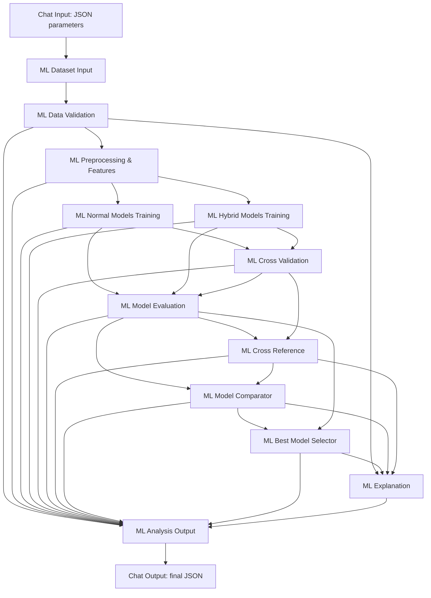

# ML model comparison (normal + hybrid models, CV, cross-reference, automatic selection)

Engine: `ai_module/ml/` (framework-agnostic). Orchestration: the Langflow flow in
`langflow_integration/` (one custom component per step). API: `POST /api/v1/ml/analysis`.
UI: **ML models** page (`/ml`).



## Data and problem

| Dataset key | Target (default) | Rows | Positives | Notes |
|---|---|---|---|---|
| `mimic_icu` | `icu_flag`: any ICU stay during the admission | 275 admissions / 100 patients | 46.5% | balanced → primary metric ROC-AUC |
| `mimic_mortality` | `died_in_hospital` | 275 / 100 | 5.5% (15) | imbalanced → PR-AUC primary, class weights, accuracy out of the score; needs ≥ 2·folds positives |

The source is the public MIMIC-IV demo processed by `python -m ai_module.digital_twin.prepare`
(see `ai_module/data/DATASET.md`). Only admission-time features are used (age, sex,
admission type and location, admission hour as sin/cos, ED arrival, transport, ESI and
triage vitals). Requests can only name registered datasets, never file paths.

## Models

| Key | Type | Algorithm |
|---|---|---|
| `logistic_regression` | normal | L2 logistic regression |
| `svm` | normal | RBF SVM + Platt calibration (`CalibratedClassifierCV`) |
| `random_forest` | normal | 300 trees, `min_samples_leaf=3` |
| `gradient_boosting` | normal | 150 shallow boosted trees (scikit-learn) |
| `xgboost` | normal | XGBoost. If the package is missing the model is **skipped** with a logged reason; the other 4 normal models always exist |
| `voting_ensemble` | **hybrid** | soft voting of Logistic Regression + Random Forest + XGBoost (Gradient Boosting if no XGBoost) |
| `stacking_ensemble` | **hybrid** | Random Forest + Gradient Boosting + SVM → out-of-fold probabilities → Logistic Regression meta-model |

LightGBM and CatBoost were not added: they would bring new dependencies without adding a
different learning principle to the set.

## Protocol (no leakage)

1. **Hold-out**: 20% of rows, `StratifiedGroupKFold` grouped by patient, so the same
   patient is never in train and test. The hold-out is never used to fit or to choose.
2. **Pipelines**: every model is `Pipeline(ColumnTransformer(impute+indicator → scale |
   one-hot | passthrough), estimator)`. Imputation, scaling and encoding are fitted only on
   the rows each fit sees.
3. **Cross-validation**: 5-fold `StratifiedGroupKFold` on the training partition. The whole
   pipeline is refitted per fold, and both train-fold and validation-fold scores are kept
   for every metric.
4. **Final fit** on the training partition gives the train score, the hold-out metrics,
   the confusion matrix and the training and inference times.
5. **Imbalance** (minority share < `AI_ML_IMBALANCE_THRESHOLD`, default 0.35): class
   weights are enabled, PR-AUC becomes the primary metric and accuracy gets zero weight.
   SMOTE is not used, so there is no synthetic data to leak.
6. The stacking meta-features use an inner `StratifiedKFold`, fitted inside each training
   set only.

## Metrics (identical for all 7 models)

Accuracy, precision, recall, F1, ROC-AUC and PR-AUC on the hold-out; the same six as CV
means and standard deviations; `cv_mean` / `cv_std` of the primary metric with per-fold
scores; `train_score`, `test_score` and `overfitting_gap = train − test`;
`cv_overfitting_gap` (mean train fold − mean validation fold); training time and
inference time (total and ms per sample).

## Cross-reference

Per model, the analysis crosses train score, CV folds and the hold-out to assess:

- **stability**: `cv_std` compared with `AI_ML_INSTABILITY_STD_THRESHOLD`, plus the coefficient of variation and the fold range;
- **generalization**: `test − cv_mean` compared with `AI_ML_CV_HOLDOUT_GAP_THRESHOLD`;
- **overfitting**: the larger of the hold-out gap and the CV gap, compared with `AI_ML_OVERFITTING_GAP_THRESHOLD`.

Across models, it reports the Spearman rank correlation between the CV ranking and the
hold-out ranking, whether both agree on the best model, the leader of each metric under
CV and under hold-out, and the gain of the best hybrid over the best normal model.

## final_score, ranking and selection

```
final_score = Σ weight_m · cv_mean_m          (m ∈ roc_auc, f1, pr_auc, accuracy)
            − instability_penalty · cv_std(primary)
            − overfitting_penalty · max(0, cv_overfitting_gap(primary))
```

- Default weights: balanced roc_auc 0.35, f1 0.30, pr_auc 0.15, accuracy 0.20;
  imbalanced 0.30 / 0.35 / 0.35 / 0. Penalties are 1.0 and 0.5.
- All weights, penalties and thresholds live in `ai_module/ml/config.py` (`MLSettings`) and
  can be overridden with `AI_ML_*` variables. When you override the weights, set all four
  so they still add up to 1, e.g.
  `AI_ML_WEIGHTS_BALANCED='{"roc_auc":0.3,"f1":0.4,"pr_auc":0.1,"accuracy":0.2}'`.
  Invalid sums are rejected at startup.
- Selection uses **cross-validated** metrics. The small hold-out would add selection bias,
  so it is used by the cross-reference step to confirm or flag the choice.
- Normal and hybrid models are scored by the same formula. Ties are broken by lower CV std,
  then shorter training time, then name.
- `BestModelSelector` takes `ranking[0]`. No model name is hard-coded anywhere, and a test
  checks this.
- If fewer than `AI_ML_MIN_VALID_MODELS` (3) models train and validate, the analysis fails
  with the recorded per-model errors. A single failing model is reported in `errors` and
  the analysis continues.

## Persistence

`ai_module/artifacts/ml_best/<run_id>/best_model.joblib` stores the fitted pipeline, which
takes raw feature columns. `metadata.json` stores the model name and type, final_score,
metrics, features, target, training date, dataset, score configuration and library
versions. `ml_best/latest.json` points to the last winner (`GET /api/v1/ml/best-model`).
Run folders with intermediate reports are in `ai_module/artifacts/ml_runs/<run_id>/`; the
last `AI_ML_KEEP_RUNS` are kept.

## Explanation

- `selection_reason` is always built by code from the real metrics: margin over the
  runner-up, CV mean ± std, F1, hold-out vs train, CV vs hold-out, overfitting, best hybrid
  vs best normal, flags, and a caveat.
- `analysis` is written by the configured LLM (`AI_LLM_*`, e.g. Gemini) **after** the
  selection. It is accepted only if it names the selected model and every number in it
  exists in the results (±rounding). Otherwise the deterministic text is used and the
  reason appears in `warnings`. The LLM never changes `best_model`.

## Output contract

```json
{
  "status": "success", "run_id": "...", "models_evaluated": 7, "models_attempted": 7,
  "normal_models": [...], "hybrid_models": [...], "comparison_table": [...], "ranking": [...],
  "best_model": {"name": "...", "type": "normal|hybrid", "final_score": 0.0, "metrics": {...}, "artifact_path": "..."},
  "best_model_metadata": {...}, "cross_validation": {...}, "cross_reference_analysis": {...},
  "score_config": {...}, "analysis": "...", "analysis_source": "llm|deterministic", "selection_reason": "...",
  "dataset": {...}, "preprocessing": {...}, "warnings": [...], "errors": [...], "duration_s": 0.0
}
```

Errors keep the same top-level keys:
`{"status": "error", "error": {"code": "...", "message": "..."}, ...}`. The codes are
`invalid_request`, `target_not_found`, `invalid_columns`, `empty_dataset`,
`insufficient_data`, `dataset_unavailable`, `not_enough_models`, `run_not_found`,
`incomplete_result` and `internal_error`. The backend maps them to 422, 503 or 502.

## Run it

```bash
python -m ai_module.digital_twin.prepare          # once: public data
python -m ai_module.ml                            # in-process, same steps as the flow (add --no-llm, --dataset, --target)
python -m pytest ai_module/tests/test_ml_comparison.py -q
```

## Verified local run (2026-09-28)

Executed with `backend/.venv/Scripts/python.exe -m ai_module.ml --no-llm`
against the prepared public MIMIC-IV demo. Run ID:
`20260928T202711Z-2d50f93f`; target `icu_flag`; five CV folds.

| Model | CV ROC-AUC | CV std | Hold-out ROC-AUC | Final score |
|---|---:|---:|---:|---:|
| Logistic Regression | 0.7291 | 0.0557 | 0.8497 | 0.5627 |
| Random Forest | 0.7193 | 0.0826 | 0.7981 | 0.4687 |
| Voting Ensemble | 0.6927 | 0.0753 | 0.8471 | 0.4465 |
| SVM (RBF) | 0.6929 | 0.0908 | 0.7594 | 0.4353 |
| Stacking Ensemble | 0.6767 | 0.0809 | 0.8368 | 0.4133 |
| Gradient Boosting | 0.6614 | 0.0798 | 0.8426 | 0.4040 |
| XGBoost | 0.6403 | 0.0895 | 0.8123 | 0.3452 |

The selected model was Logistic Regression. Its report flags CV variability
(std 0.056), a CV train-validation gap of 0.128, and a hold-out/CV difference
of +0.121. These are results on a small public demo, not evidence of clinical
validation. The explanation was deterministic; no LLM was called.

The same public demo was also executed through the exported Langflow graph
with Langflow 1.12.3 / Python 3.13. Run `20260928T204838Z-00c2fba1` evaluated
all seven models in 37.23 seconds and selected Logistic Regression with the
same final score (0.5627). The smoke check also confirmed that an invalid
dataset returns a structured error at Chat Output. See the
[Langflow setup and verification commands](../langflow_integration/README.md).
